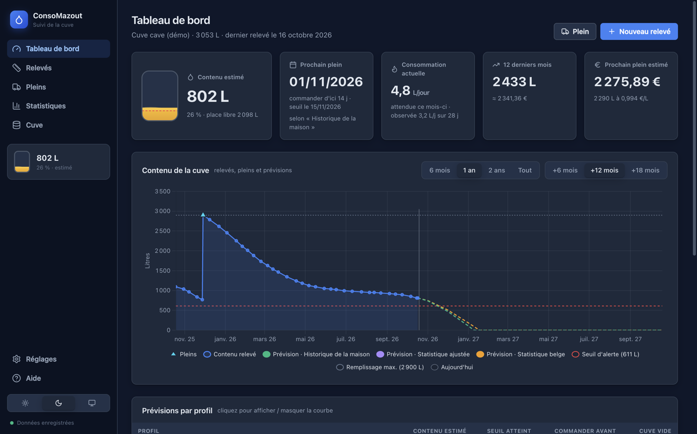

# ConsoMazout

Application de bureau (**Angular 21 + Electron**) pour suivre la consommation de mazout de la maison :

- **Cuve** décrite une fois : cylindre couché, rectangulaire, cylindre debout ou table de jaugeage, avec la gestion des batteries de cuves.
- **Relevés** de hauteur, convertis en litres. Ils peuvent être datés dans le passé.
- **Pleins** avec litres et prix, eux aussi datables dans le passé.
- **Statistiques** par mois, par saison et par année, avec comparaison à une référence belge.
- **Prévisions** selon la saison : statistique belge, statistique recalée sur la consommation observée, historique réel de la maison. L'application en déduit la date de commande conseillée.
- **Plusieurs ordinateurs** : export JSON, puis import qui fusionne. Seuls les relevés et pleins absents sont ajoutés ; rien n'est modifié ni supprimé.
- **Assistant IA (Claude)** : questions en langage naturel sur toutes les données. La clé API est chiffrée par le système et n'est utilisée que dans le process principal.
- Thèmes **clair / sombre / système**, interface en CSS natif, sans bibliothèque de composants.

Le mode d'emploi complet est dans **[docs/GUIDE-UTILISATEUR.md](docs/GUIDE-UTILISATEUR.md)**. Il est aussi lisible dans l'application, page *Aide*.



## Démarrage

Il faut Node.js 22.12 ou plus récent.

```bash
npm install
npm run dev          # Angular (http://localhost:4200) + Electron avec rechargement
npm run start:prod   # build de production puis lancement d'Electron
npm test             # tests unitaires (Vitest) : interface puis process principal (npm run test:electron)
```

`npm run dev:ng` lance seulement l'interface dans un navigateur. Sans Electron, les données sont alors conservées dans le `localStorage` du navigateur.

Un fichier `.npmrc` local force le registre public `registry.npmjs.org`.

## Vidéo de présentation

```bash
npm run video   # build, puis tournage piloté par Playwright → docs/video/consomazout-presentation.mp4
```

[`scripts/video/record-demo.mjs`](scripts/video/record-demo.mjs) lance l'application Electron avec Playwright, dans un dossier de données temporaire préchargé avec la démo. Il y déroule les cas d'usage principaux :

- encodage d'un relevé, aussi dans le passé ;
- encodage d'une recharge ;
- consultation de l'évolution ;
- prévisions ;
- statistiques ;
- passage au thème clair.

Les images sont capturées par le protocole DevTools (screencast), avec sous-titres et curseur dessinés dans la page, puis assemblées en MP4 1920×1200 par ffmpeg (`brew install ffmpeg`). La vidéo générée n'est pas versionnée.

## Construire les installeurs

```bash
./release/build.sh       # release/consomazout-<version>-mac-arm64.dmg (macOS uniquement)
./release/build-win.sh   # release/consomazout-<version>-win-x64.exe (installeur NSIS)
```

Les scripts lancent `npm ci` si les dépendances manquent ou sont périmées, puis les tests, puis `npm run dist:mac` ou `npm run dist:win`.

- L'installeur Windows se construit depuis un Mac sans Wine. Sur Apple Silicon, il faut Rosetta 2 : `softwareupdate --install-rosetta --agree-to-license`.
- Sur un PC Windows, lancer directement `npm ci && npm run dist:win`.
- La configuration est dans [`electron-builder.yml`](electron-builder.yml) et les icônes dans [`build/`](build).

Les paquets ne sont pas signés. Sur macOS, lever la quarantaine avec `xattr -dr com.apple.quarantine /Applications/ConsoMazout.app`. Sur Windows, SmartScreen demande « Exécuter quand même ».

## Architecture

```
electron/                  Process principal (TypeScript → dist-electron/)
  main.ts                  fenêtre durcie, protocole app://, IPC, thème natif
  preload.ts               pont contextBridge → window.consoMazout
  storage.ts               fichier JSON (écriture atomique + copie .bak)
  ai.ts                    assistant Claude (SDK officiel @anthropic-ai/sdk) : réponses en flux, repli serveur, erreurs typées
  secrets.ts               clé API chiffrée par safeStorage (Trousseau macOS / DPAPI Windows)
  shared/ipc-contract.ts   types partagés avec l'interface
src/app/
  core/models/             modèle de données, validation et fusion des fichiers importés (merge.ts)
  core/calc/               calculs purs et testés :
    tank-volume.ts           volume selon la forme (segment circulaire, interpolation…)
    degree-days.ts           degrés-jours normaux d'Uccle, profil de référence
    consumption.ts           consommation entre relevés, répartition journalière saisonnière
    stats.ts                 tableaux mensuels, moyennes, saisons, prix
    forecast.ts              profils de prévision et simulation jour par jour
    analysis.ts              assemblage complet utilisé par l'interface
  core/ai/                 contexte envoyé à Claude (instantané de toutes les données) et conversation
  core/services/           DataStore (signals + sauvegarde auto), stockage, thème, toasts
  shared/                  icônes SVG, jauge de cuve, enveloppe Chart.js, formats fr-BE
  pages/                   tableau de bord, relevés, pleins, statistiques, cuve, réglages, aide
docs/                      guide utilisateur (embarqué dans l'app) et captures d'écran
release/                   scripts de build .dmg / .exe
```

### Données

Toutes les données sont dans un seul fichier JSON :

- macOS : `~/Library/Application Support/ConsoMazout/consomazout.json`
- Windows : `%APPDATA%\ConsoMazout\consomazout.json`

Seules les **hauteurs** des relevés sont stockées. Les litres sont toujours recalculés depuis la description de la cuve.

En développement, la variable `CONSOMAZOUT_USER_DATA=/un/dossier` isole les données.

### Calcul de la consommation

Entre deux relevés, la consommation vaut `litres(relevé 1) + pleins livrés entre les deux − litres(relevé 2)`.

Elle est répartie jour par jour au prorata d'un poids saisonnier : part d'eau chaude constante, plus part de chauffage proportionnelle aux degrés-jours du mois. Les totaux mensuels restent ainsi réalistes même avec des relevés espacés. Un mois n'entre dans les moyennes que s'il est entièrement couvert par des relevés.

### Données de référence

- Consommation annuelle de référence : 2 000 L/an, réglable. Ordre de grandeur tiré du bilan énergétique wallon (environ 19 300 kWh par ménage pour le chauffage et l'eau chaude) et de la fourchette courante de 1 500 à 2 500 L/an pour une maison de 100 à 150 m².
- Saisonnalité : degrés-jours 15/15 normaux à Uccle (IRM).
- Eau chaude : 300 L/an pour 4 personnes (estimation).
