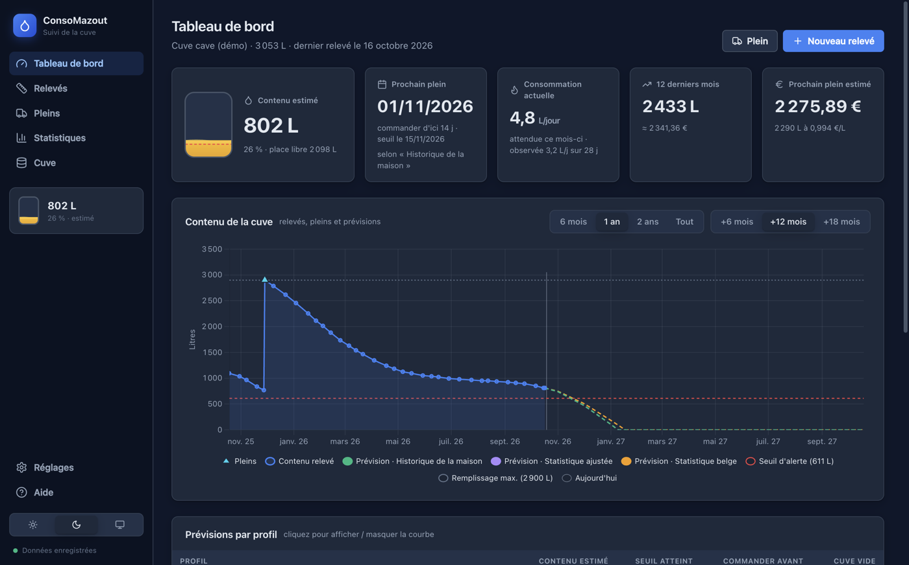
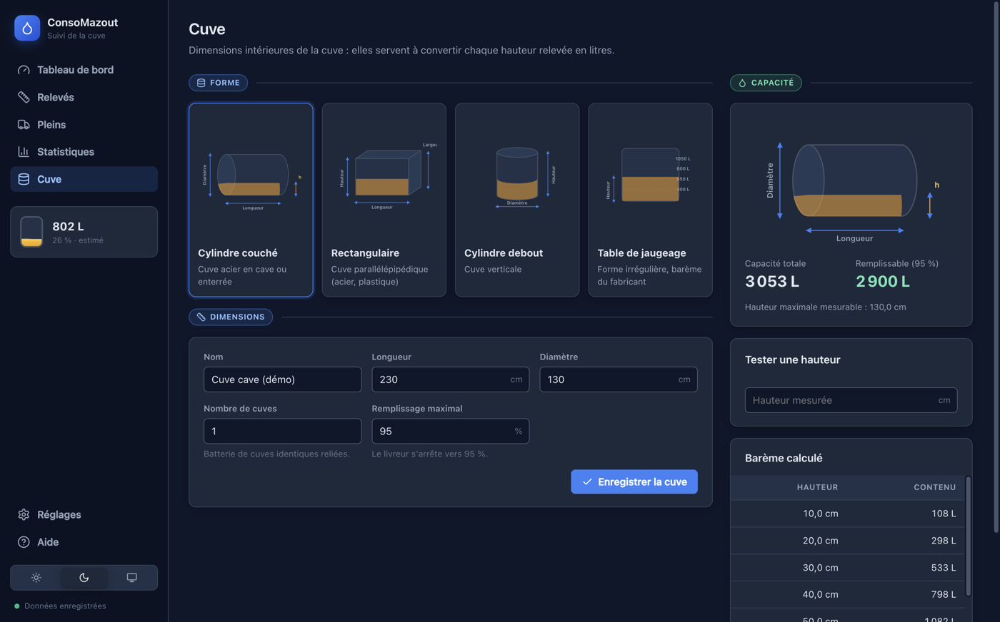
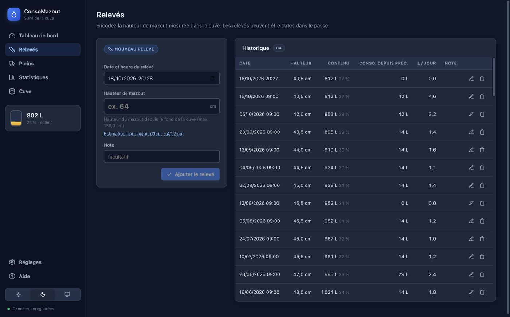
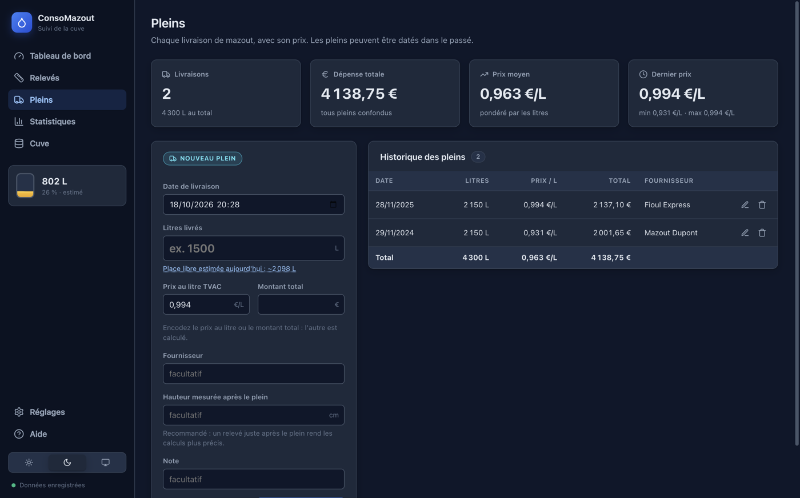
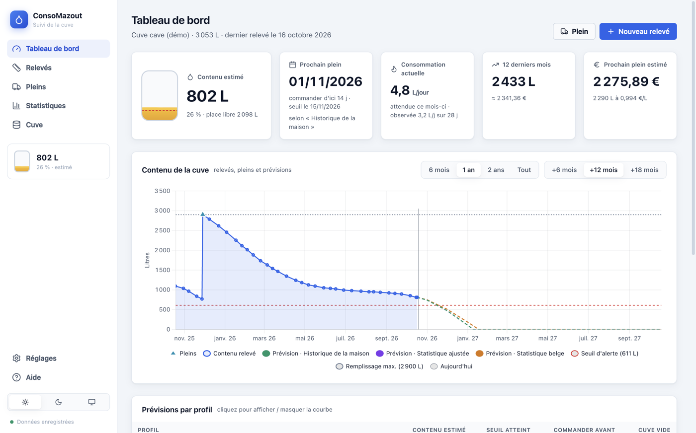
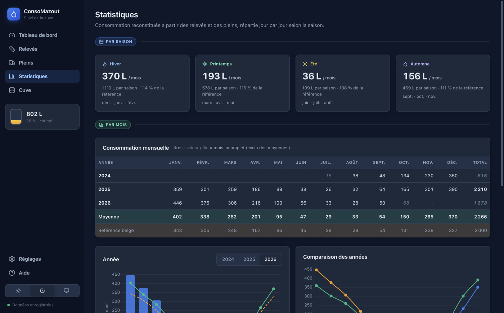
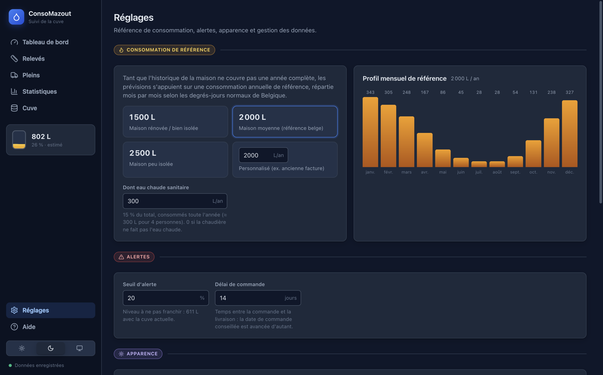

# Guide utilisateur de ConsoMazout

ConsoMazout suit le contenu de votre cuve à mazout, calcule votre consommation par mois, par saison et par année, et prévoit quand le prochain plein devra être commandé.



## Présentation

Le principe est simple :

1. Vous décrivez **une seule fois** la cuve : sa forme et ses dimensions intérieures.
2. Vous encodez **régulièrement un relevé** : la hauteur de mazout mesurée dans la cuve. L'application la convertit en litres.
3. Vous encodez **chaque plein** : les litres livrés et le prix payé.

À partir de ces données, ConsoMazout reconstitue votre consommation et la compare à des statistiques belges. Il prévoit ensuite l'évolution de la cuve selon la saison et vous indique la date à laquelle commander.

> Les relevés et les pleins peuvent être encodés **dans le passé**. Reprenez vos anciennes factures de livraison et vos anciennes mesures : plus l'historique est long, meilleures sont les prévisions.

## Installation

### macOS (Apple Silicon)

1. Ouvrez le fichier `consomazout-<version>-mac-arm64.dmg`.
2. Glissez **ConsoMazout** dans le dossier **Applications**.
3. L'application n'est pas signée par un certificat Apple. Si macOS refuse de l'ouvrir (« endommagée » ou « développeur non identifié »), levez la quarantaine une fois dans le Terminal :

```bash
xattr -dr com.apple.quarantine /Applications/ConsoMazout.app
```

### Windows

1. Lancez `consomazout-<version>-win-x64.exe`.
2. L'installeur n'est pas signé : Windows SmartScreen affiche un avertissement. Cliquez sur **Informations complémentaires** puis sur **Exécuter quand même**.
3. Choisissez le dossier d'installation. Aucun droit administrateur n'est nécessaire. Un raccourci est créé sur le bureau et dans le menu Démarrer.

### Construire l'application soi-même

Depuis les sources, sur un Mac, avec Node.js 22 ou plus récent :

```bash
./release/build.sh       # crée release/consomazout-<version>-mac-arm64.dmg
./release/build-win.sh   # crée release/consomazout-<version>-win-x64.exe
```

Pour construire l'installeur Windows sur un Mac Apple Silicon, Rosetta 2 est nécessaire. Le script indique comment l'installer s'il manque.

## Premier démarrage

Au premier lancement, le tableau de bord propose deux choix :

- **Configurer ma cuve** : c'est le point de départ pour vos propres données.
- **Essayer avec des données de démo** : une cuve fictive de 3 000 L et deux ans de relevés et de pleins, pour découvrir toutes les fonctions. Vous effacerez ensuite ces données dans **Réglages → Tout effacer**.

La barre latérale donne accès aux pages. Elle affiche en permanence le **contenu estimé** de la cuve, et en bas le choix du thème et l'état de l'enregistrement.

## Configurer la cuve



Choisissez d'abord la **forme** de la cuve :

| Forme | Cotes à mesurer | Exemple |
| --- | --- | --- |
| Cylindre couché | diamètre et longueur | cuve acier en cave ou enterrée |
| Rectangulaire | longueur, largeur, hauteur | cuve acier ou plastique parallélépipédique |
| Cylindre debout | diamètre et hauteur | cuve verticale |
| Table de jaugeage | barème hauteur → litres | forme irrégulière, cuve à parois bombées |

Conseils de mesure :

- Mesurez les dimensions **intérieures**. Pour une cuve en acier, retirez l'épaisseur de la paroi (quelques millimètres) des dimensions extérieures.
- Pour une **batterie** de cuves identiques reliées entre elles, décrivez une seule cuve et indiquez leur nombre dans **Nombre de cuves**.
- Le **remplissage maximal** (95 % par défaut) correspond à la limite à laquelle le livreur arrête le remplissage. Il sert à calculer la place libre et la quantité à commander.

Pour une cuve de forme irrégulière, le fabricant fournit souvent un **barème de jaugeage**. Choisissez *Table de jaugeage* et encodez les points un par un. Vous pouvez aussi coller le barème entier, une ligne « hauteur ; litres » par point. Entre deux points, l'application interpole les litres.

À droite, la page affiche la capacité calculée, un **testeur** (hauteur → litres) et le **barème calculé** tous les 10 cm. Comparez-le avec la jauge de votre cuve pour vérifier vos mesures.

> Modifier la cuve recalcule tout l'historique : seules les hauteurs sont enregistrées, et les litres sont toujours recalculés à partir de la description de la cuve.

## Encoder un relevé



### Comment mesurer

- Avec une **règle ou un bâton gradué** plongé verticalement jusqu'au fond de la cuve : la hauteur mouillée est la hauteur de mazout.
- Avec une **jauge** mécanique ou électronique graduée en centimètres.
- Mesurez toujours au même endroit, de préférence au milieu de la cuve. Une précision de 0,5 cm suffit.

### Saisie

1. Ouvrez **Relevés**.
2. La date et l'heure sont pré-remplies avec l'instant présent. Modifiez-les pour encoder un **relevé passé**.
3. Encodez la **hauteur en cm**. L'aperçu affiche aussitôt les litres, le pourcentage de remplissage et la consommation depuis le relevé précédent.
4. Cliquez sur **Ajouter le relevé**.

Le lien **Estimation pour aujourd'hui** propose la hauteur prévue par l'application, ce qui aide à repérer une erreur de mesure.

Le tableau **Historique** affiche, pour chaque relevé, le contenu, la consommation depuis le relevé précédent et la moyenne en litres par jour. Les boutons de la ligne permettent de **modifier** ou de **supprimer** un relevé.

### Incohérences

Si le niveau **monte** entre deux relevés sans qu'un plein suffisant ait été encodé, la ligne affiche un badge orange **incohérence**. Les causes possibles :

- un **plein oublié** : encodez-le à sa date ;
- une **erreur de mesure** ou de saisie : corrigez le relevé.

Une incohérence est comptée comme une consommation nulle, pour ne pas fausser les statistiques.

### Fréquence conseillée

Un relevé toutes les **une à deux semaines** donne de très bonnes statistiques. Relevez aussi juste **avant et après chaque plein** : c'est ce qui rend les calculs les plus précis.

## Encoder un plein



1. Ouvrez **Pleins**.
2. Indiquez la **date de livraison** (passée si nécessaire) et les **litres livrés**, tels qu'indiqués sur la facture.
3. Encodez le **prix au litre TVAC** ou le **montant total** : l'autre valeur est calculée automatiquement. Le dernier prix payé est proposé par défaut.
4. Le **fournisseur** est facultatif ; les fournisseurs déjà utilisés sont proposés à la saisie.
5. **Hauteur mesurée après le plein** (facultatif mais recommandé) : un relevé est créé automatiquement à la même date.

Le lien **Place libre estimée aujourd'hui** remplit les litres avec la quantité qu'on peut encore ajouter dans la cuve. C'est utile au moment de commander.

En haut de la page, les indicateurs résument le nombre de livraisons, la dépense totale, le prix moyen (pondéré par les litres) et le dernier prix payé.

> Un plein seul ne suffit pas à connaître le niveau de la cuve. Les calculs reposent sur les **relevés** : le plein est ajouté au niveau du relevé qui le précède.

## Le tableau de bord



### Indicateurs

- **Contenu estimé** : litres et pourcentage estimés **aujourd'hui**, à partir du dernier relevé moins la consommation prévue depuis. La jauge affiche le seuil d'alerte en pointillés rouges.
- **Prochain plein** : la **date limite pour commander**, c'est-à-dire la date à laquelle le seuil d'alerte sera atteint moins le délai de livraison. L'indicateur passe en orange (« À commander ») puis en rouge (« Sous le seuil »).
- **Consommation actuelle** : litres par jour attendus ce mois-ci, et consommation réellement observée sur les 30 derniers jours.
- **12 derniers mois** : consommation et coût estimé sur l'année glissante.
- **Prochain plein estimé** : coût d'un remplissage jusqu'au maximum autorisé, au dernier prix payé.

### Graphique « Contenu de la cuve »

- **Ligne bleue pleine** : contenu calculé à chaque relevé.
- **Triangles** : les pleins. Survolez-en un pour voir les litres et le prix.
- **Lignes pointillées** : les prévisions, une par profil (voir ci-dessous).
- **Ligne rouge** : le seuil d'alerte. **Ligne grise pointillée** : le remplissage maximal.
- **Trait vertical** : aujourd'hui.

Les boutons au-dessus du graphique règlent la période d'historique affichée (6 mois à tout) et l'horizon de prévision (6 à 18 mois). Cliquez sur un élément de la légende pour masquer ou afficher la courbe correspondante.

### Prévisions par profil

Le tableau compare, pour chaque profil, le contenu estimé, la date du seuil, la **date de commande** et la date à laquelle la cuve serait vide. Cliquez sur une ligne pour afficher ou masquer sa courbe. Le badge **retenu** indique le profil utilisé pour les indicateurs.

Le graphique **Consommation prévue** montre, mois par mois, la consommation attendue pour les 12 prochains mois selon chaque profil.

## Comprendre les prévisions

ConsoMazout calcule trois profils de consommation mensuelle.

| Profil | Disponible | Principe |
| --- | --- | --- |
| **Statistique belge** | toujours | consommation de référence (2 000 L/an par défaut) répartie selon les degrés-jours |
| **Statistique ajustée** | après quelques semaines de relevés | profil belge multiplié par le rapport entre votre consommation observée et la consommation attendue sur la même période |
| **Historique de la maison** | quand chaque mois de l'année a été entièrement couvert au moins une fois | moyenne réelle de chaque mois sur les années précédentes |

Les indicateurs utilisent le **meilleur profil disponible** : l'historique, sinon la statistique ajustée, sinon la statistique belge.

### La saisonnalité

La consommation de chauffage est proportionnelle aux **degrés-jours** : plus il fait froid, plus on chauffe. ConsoMazout utilise les degrés-jours 15/15 normaux d'Uccle (IRM). Janvier pèse ainsi environ 110 fois plus que juillet. L'eau chaude sanitaire, elle, est consommée de façon constante toute l'année.

Avec 2 000 L/an dont 300 L d'eau chaude, cela donne par exemple environ 343 L en janvier, 167 L en avril, 28 L en juillet et 131 L en octobre.

### La répartition entre deux relevés

Quand deux relevés sont espacés (par exemple de février à mai), la consommation mesurée est **répartie jour par jour selon le poids de chaque saison**. Février en reçoit donc beaucoup plus que mai. C'est ce qui permet d'obtenir des consommations mensuelles réalistes même avec des relevés irréguliers.

### Seuil et délai de commande

- Le **seuil d'alerte** (20 % de la capacité par défaut) est le niveau en dessous duquel vous ne voulez pas descendre.
- Le **délai de commande** (14 jours par défaut) est le temps entre la commande et la livraison.
- La **date de commande conseillée** est la date du seuil moins ce délai.

## Statistiques



- **Par saison** : consommation moyenne par mois et total moyen de chaque saison (hiver = décembre à février, printemps = mars à mai, été = juin à août, automne = septembre à novembre), avec le pourcentage par rapport à la référence belge.
- **Consommation mensuelle** : tableau des années et des mois. Les valeurs en italique pâle sont des **mois incomplets**, pas entièrement couverts par des relevés : elles sont exclues des moyennes. Les lignes **Moyenne** et **Référence belge** permettent la comparaison.
- **Année** : barres mensuelles de l'année choisie, avec la moyenne observée et la référence belge.
- **Comparaison des années** : une courbe par année pour comparer les hivers.
- **Par année** : litres consommés, litres livrés et dépense.
- **Prix au litre** : évolution du prix payé à chaque plein.

## Réglages



### Consommation de référence

Choisissez le profil qui ressemble le plus à votre maison :

- **1 500 L** : maison rénovée ou bien isolée ;
- **2 000 L** : maison moyenne, la référence belge ;
- **2 500 L** : maison peu isolée ;
- **Personnalisé** : par exemple la consommation annuelle tirée de vos anciennes factures.

Indiquez aussi la part d'**eau chaude sanitaire** : environ 300 L/an pour 4 personnes. Mettez 0 si votre chaudière ne produit pas l'eau chaude. Le graphique à droite montre aussitôt le profil mensuel obtenu.

Cette référence n'a plus d'effet sur les indicateurs dès que l'historique de la maison est disponible. Elle reste affichée pour comparaison.

### Alertes

Le **seuil d'alerte** et le **délai de commande** sont décrits dans la section *Comprendre les prévisions*.

### Thème

Choisissez **Clair**, **Sombre** ou **Système**. Le mode Système suit le réglage de macOS ou de Windows. Le choix est aussi disponible en bas de la barre latérale.

## Sauvegarde et données

Les données sont **enregistrées automatiquement** à chaque modification. Le point vert en bas de la barre latérale le confirme. Elles sont stockées dans un fichier JSON :

| Système | Emplacement |
| --- | --- |
| macOS | `~/Library/Application Support/ConsoMazout/consomazout.json` |
| Windows | `%APPDATA%\ConsoMazout\consomazout.json` |

La version précédente du fichier est conservée à côté, sous le nom `consomazout.json.bak`. Si le fichier principal est illisible, l'application restaure automatiquement cette copie. Dans **Réglages → Données**, le bouton **Afficher** ouvre le dossier.

- **Exporter (JSON)** : une sauvegarde complète (cuve, relevés, pleins, réglages), à conserver ou à transférer vers un autre ordinateur.
- **Importer…** : remplace toutes les données par celles d'un fichier exporté.
- **CSV** : les relevés, les pleins ou la consommation mensuelle, au format attendu par Excel en Belgique (séparateur « ; », virgule décimale).
- **Charger la démo** et **Tout effacer** : pour découvrir l'application ou repartir de zéro. Pensez à exporter vos données avant.

## Sources des données de référence

- **Consommation annuelle** : le bilan énergétique de la Wallonie (secteur domestique) estime la consommation moyenne d'un ménage pour le chauffage et l'eau chaude à environ 19 300 kWh/an, soit environ 1 950 L de mazout (un litre de mazout ≈ 10 kWh). Une maison de 100 à 150 m² consomme couramment de 1 500 à 2 500 L/an selon son isolation. Sources : [SPW Énergie – bilans énergétiques](https://energie.wallonie.be/servlet/Repository/bilan-2020-domestique-et-equivalents.pdf?ID=76237).
- **Saisonnalité** : degrés-jours 15/15 normaux à Uccle, publiés par l'IRM. De janvier à décembre : 365,1 · 321,6 · 256,5 · 162,8 · 69,9 · 22,7 · 3,3 · 4,0 · 33,0 · 122,2 · 245,2 · 346,8 (total 1 953,1). Source : [IRM – degrés-jours](https://www.meteo.be/fr/services/produits-et-services/degres-jours).
- **Eau chaude sanitaire** : environ 300 L/an pour un ménage de 4 personnes, soit environ 15 % de la consommation totale. C'est une estimation.

Ces chiffres sont des ordres de grandeur. Votre propre historique les remplace dès qu'il couvre une année complète.

## Questions fréquentes

**Les prévisions me semblent fausses au début.**
Avec peu de relevés, l'application s'appuie sur la statistique belge. Après quelques semaines, la *statistique ajustée* se recale sur votre consommation réelle. Vous pouvez aussi choisir une référence plus proche de votre maison dans les Réglages.

**Quand le profil « Historique de la maison » sera-t-il disponible ?**
Quand chacun des 12 mois de l'année aura été entièrement couvert par des relevés au moins une fois. En pratique, il faut un an de relevés sans trou, ou des relevés anciens encodés dans le passé.

**Un mois apparaît en italique dans les statistiques.**
Il n'est pas entièrement couvert : le premier relevé est postérieur au début du mois, ou le dernier relevé est antérieur à sa fin. Il est affiché mais exclu des moyennes.

**J'ai oublié d'encoder un plein il y a plusieurs mois.**
Encodez-le simplement à sa date : tous les calculs sont refaits. Le badge d'incohérence du relevé suivant disparaît.

**Le contenu estimé diffère de ma mesure.**
L'estimation est une prévision faite depuis le dernier relevé. Encodez un nouveau relevé : il fait foi.

**Je change de cuve.**
Exportez vos données, puis effacez-les ou modifiez la description de la cuve. Attention : modifier la cuve recalcule aussi les anciens relevés avec les nouvelles dimensions.

**Comment transférer mes données sur un autre ordinateur ?**
**Réglages → Exporter (JSON)** sur l'ancien ordinateur, puis **Importer…** sur le nouveau.
